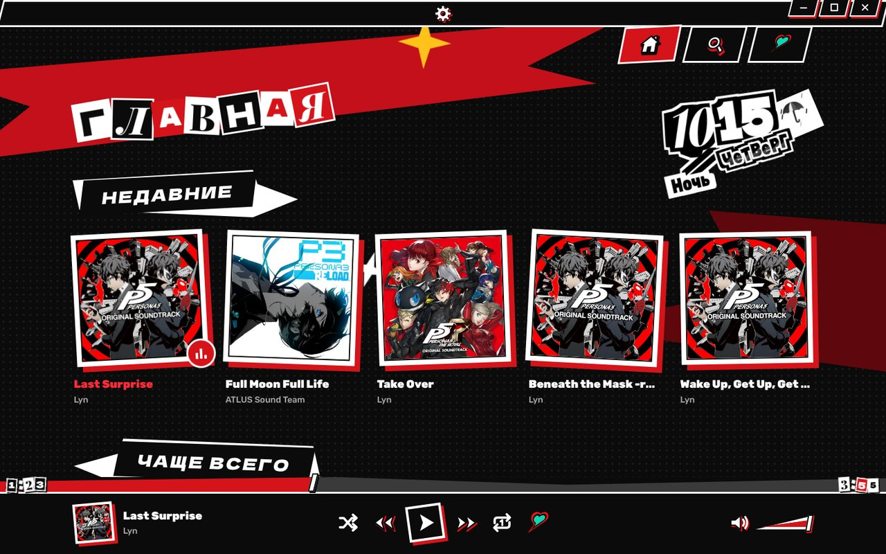
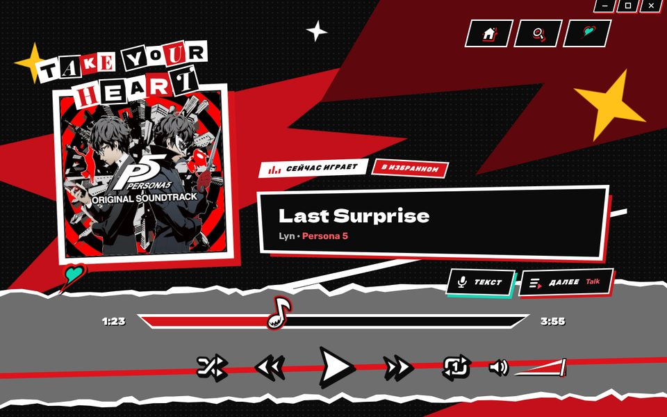
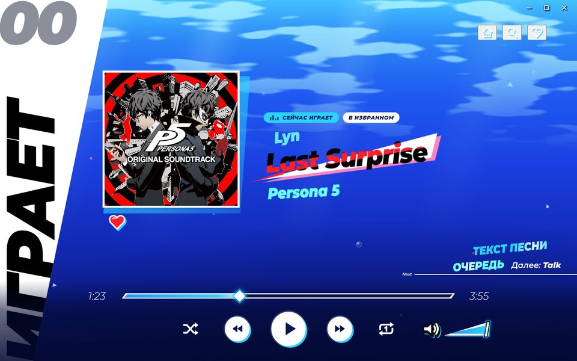
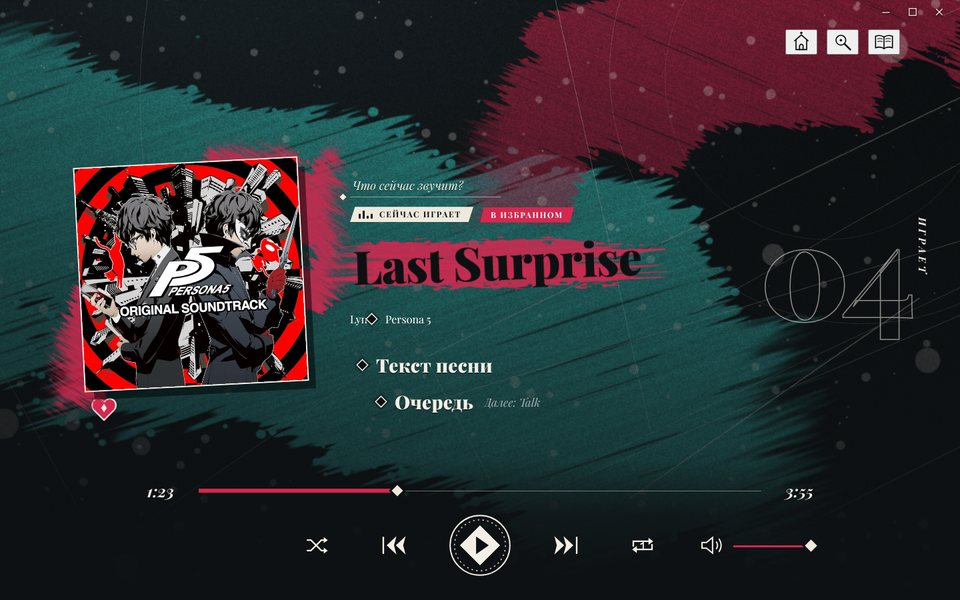
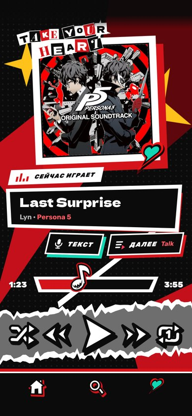
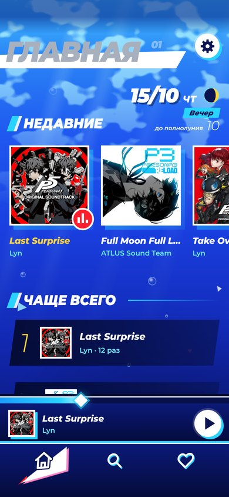
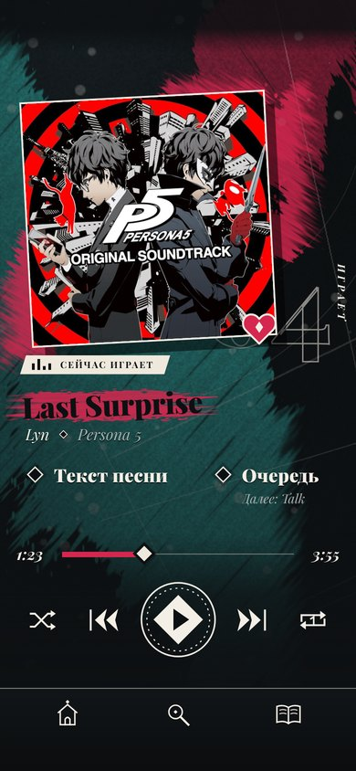

<div align="center">


# Personafy

**Музыкальный плеер в стиле Persona 5 — для Windows, iPhone и Android**

Три темы оформления по мотивам игр: Persona 5, Persona 3 Reload и Metaphor: ReFantazio

[](https://github.com/tornoment/personafy/raw/installer/Personafy-Setup.exe)
[](https://github.com/tornoment/personafy/raw/android/Personafy.apk)
[](https://github.com/tornoment/personafy/tree/ios)



</div>

## Темы

<table>
  <tr>
    <td width="33%" align="center"></td>
    <td width="33%" align="center"></td>
    <td width="33%" align="center"></td>
  </tr>
  <tr>
    <td align="center"><b>Persona 5</b><br><sub>Вырезанные буквы, косые полосы, календарь как в игре</sub></td>
    <td align="center"><b>Persona 3 Reload</b><br><sub>Меню паузы, море и блики, отсчёт до полнолуния</sub></td>
    <td align="center"><b>Metaphor: ReFantazio</b><br><sub>Чернила и мазки краски, плашки как в списке отряда</sub></td>
  </tr>
</table>

Тема переключается в настройках сразу, без перезапуска. Каждая перерисовывает весь плеер: меню, списки, кнопки, переходы между разделами и даже рамку окна.

## На телефоне

<p align="center">
  &nbsp;&nbsp;
  &nbsp;&nbsp;
  
</p>

Тот же интерфейс и все три темы, разложенные под узкий экран: разделы внизу, плеер над ними, «Сейчас играет» помещается на один экран.

## Возможности

- **Музыка из облака.** Треки лежат в общей папке на Google Диске и играют прямо оттуда. Новые альбомы плеер находит сам, а длительность, исполнителя и год читает из файлов.
- **Офлайн.** Любимые треки можно скачать; обложки и найденные тексты сохраняются на устройстве.
- **Тексты песен** с подсветкой текущей строки (из открытой базы LRCLIB). Щелчок по строке перематывает к ней.
- **Выравнивание громкости** — тихие и громкие альбомы звучат одинаково.
- **Очередь** с перетаскиванием, «Играть следующим», повтор трека, перемешивание и избранное.
- **Живая Главная** — дата, время суток и настоящая погода в стиле выбранной игры.
- **Переходы между разделами** — полосы в Persona 5, вода в Persona 3 Reload, мазки краски в Metaphor.
- **Windows:** своя рамка окна, горячие клавиши, мультимедийные клавиши клавиатуры и медиапанель Windows.
- **Телефоны:** музыка играет в фоне и с выключенным экраном, свайп по плееру переключает трек. На Android — плеер в шторке и на экране блокировки, кнопки наушников и жест «Назад».

## Установка

| Платформа | Как установить |
|---|---|
| **Windows** | Скачайте [Personafy-Setup.exe](https://github.com/tornoment/personafy/raw/installer/Personafy-Setup.exe) и запустите. Если появится «Система Windows защитила ваш компьютер» — «Подробнее» → «Выполнить в любом случае». |
| **Android** | Откройте [Personafy.apk](https://github.com/tornoment/personafy/raw/android/Personafy.apk) в браузере телефона, скачайте и установите. Пошагово — [в ветке `android`](https://github.com/tornoment/personafy/tree/android). |
| **iPhone** | [Personafy.ipa](https://github.com/tornoment/personafy/raw/ios/Personafy.ipa) ставится с компьютера через Sideloadly с бесплатным Apple ID; подпись действует 7 дней, потом файл ставится заново. Пошагово — [в ветке `ios`](https://github.com/tornoment/personafy/tree/ios). |

Новая версия везде ставится поверх старой — избранное, очередь и скачанные треки сохраняются.

### Горячие клавиши (Windows)

| Клавиша | Действие |
|---|---|
| <kbd>Пробел</kbd> | Пауза / играть |
| <kbd>←</kbd> <kbd>→</kbd> | Перемотка на 5 секунд |
| <kbd>Ctrl</kbd> + <kbd>←</kbd> <kbd>→</kbd> | Предыдущий / следующий трек |
| <kbd>Ctrl</kbd> + <kbd>↑</kbd> <kbd>↓</kbd> | Громкость |
| <kbd>R</kbd> | Повтор трека |
| <kbd>Ctrl</kbd> + <kbd>F</kbd> | Поиск |
| <kbd>Esc</kbd> | Закрыть очередь или меню |

## Сборка

Плеер для Windows — Electron и чистый JavaScript без фреймворков. Нужен Node.js 20+ (на Linux для сборки установщика — ещё wine).

```sh
cd app
npm install
npm start          # запустить плеер
npm run dist       # собрать dist/Personafy Setup.exe
```

Если `npm run dist` на Windows падает с «Cannot create symbolic link» при распаковке winCodeSign — включите «Режим разработчика» (Параметры → Система → Для разработчиков) или запустите сборку от имени администратора: архиву нужны символьные ссылки.

Версии для телефонов — тот же интерфейс в обёртке Capacitor. Приложения собирает GitHub Actions по кнопке «Run workflow» у **iPhone build** и **Android build** (или по тегу `ios-…` / `android-…`); готовые файлы появляются в ветках `ios` и `android`. Посмотреть, как выглядят экраны телефона, можно и без телефона:

```sh
cd mobile
npm ci
npm run build:web
python3 scripts/preview.py    # снимки всех экранов трёх тем (нужен Playwright)
```

<details>
<summary><b>Что где лежит</b></summary>

| Папка | Что там |
|---|---|
| `app/main.js` | Основной процесс Electron: окно, проигрывание с Google Диска, скачивание, тексты, погода, обложки |
| `app/preload.js` | Мост между окном и основным процессом |
| `app/src/` | Интерфейс: `app.js`, стили тем (`styles.css` — Persona 5, `p3r.css`, `mf.css`), шрифты, текстуры краски, каталог треков |
| `app/build/` | Значки приложения |
| `build-data/` | Исходные данные каталога и картинка для значка |
| `mobile/` | Версии для iPhone и Android: проекты Capacitor, мост к Диску и файлам (`web/phone-api.js`), раскладка телефона (`web/phone.css`), Android-добавки (`web/android.js`), скрипты сборки, снимков и проверки |
| `tools/` | Генераторы значков и текстур темы Metaphor |
| `.github/workflows/` | Сборка приложений для iPhone и Android |

</details>

Подробнее об устройстве плеера — в [docs/как-устроено.md](docs/как-устроено.md), история версий — в [CHANGELOG.md](CHANGELOG.md).

---

<sub>Неофициальный фанатский проект, не связан с ATLUS и SEGA; Persona и Metaphor: ReFantazio — их товарные знаки. Тексты песен — [LRCLIB](https://lrclib.net), погода — [Open-Meteo](https://open-meteo.com). Шрифты распространяются по лицензии SIL Open Font License.</sub>
